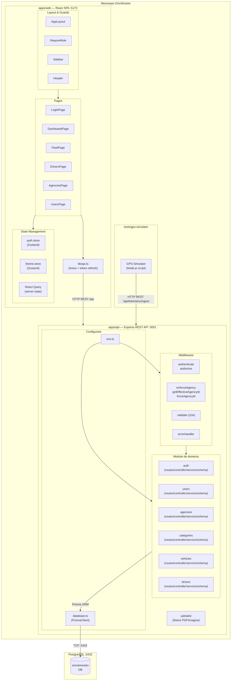
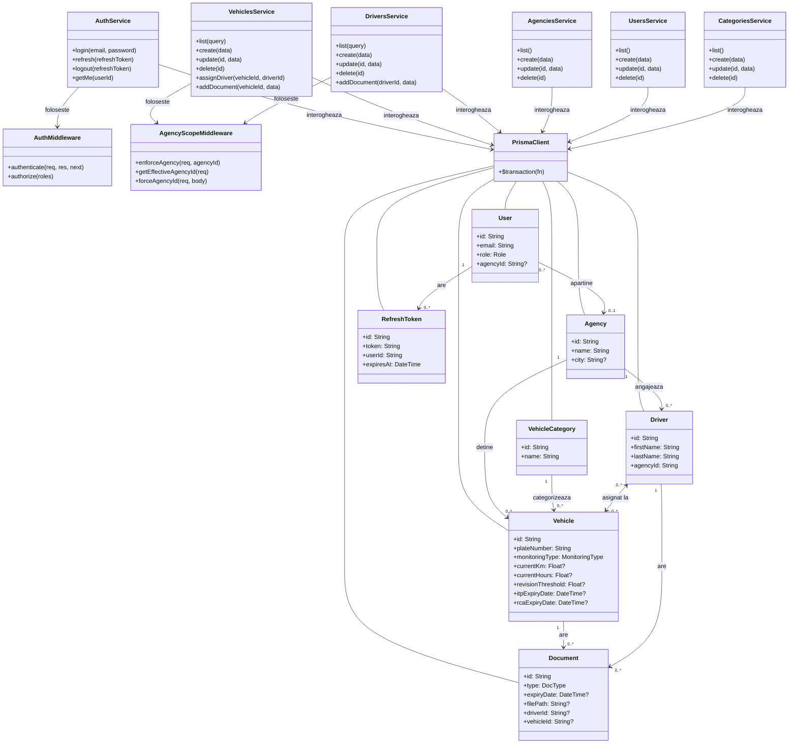
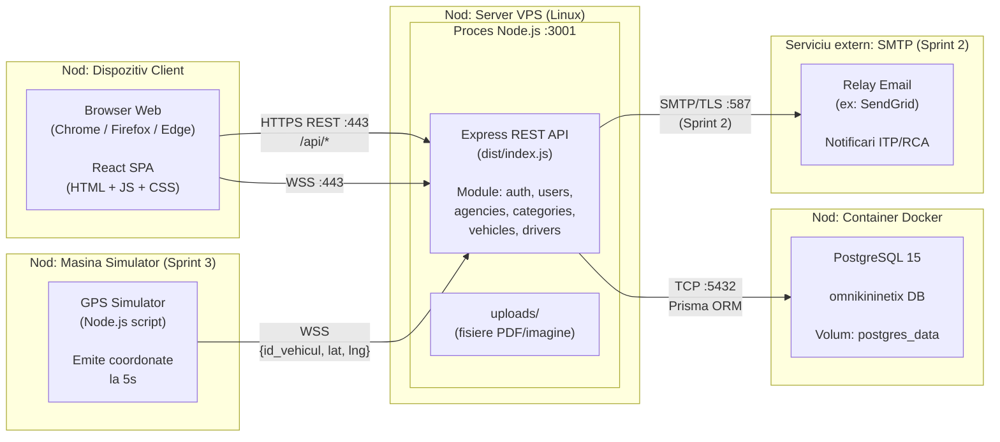
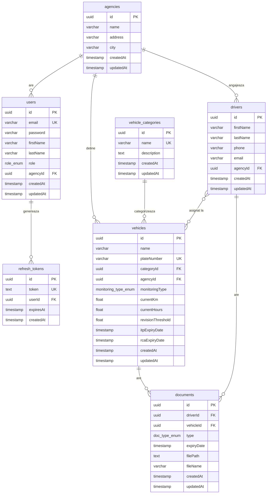

# Documentul de Proiectare Arhitecturala (ADD)

## Platforma de Management si Telemetrie Flota Auto / Utilaje (SaaS) — **OmniKinetix**

---

## Cuprins

1. Introducere
   - 1.1 Scopul sistemului
   - 1.2 Definitii, acronime
   - 1.3 Documente referinta
2. Obiective de proiectare
3. Arhitectura propusa
   - 3.1 Decompozitia in subsisteme — Diagrama de componente, Diagrama claselor
   - 3.2 Distributia subsistemelor pe platforme hardware/software — Diagrama de distributie
   - 3.3 Managementul datelor persistente — Diagrama bazei de date
   - 3.4 Controlul accesului utilizatorilor la sistem
   - 3.5 Fluxul global al controlului — Diagrama de activitate
   - 3.6 Tratarea conditiilor limita
4. Glosar de termeni

---

## 1. Introducere

### 1.1 Scopul sistemului

OmniKinetix este o platforma SaaS (Software as a Service) de management si telemetrie pentru flote auto si utilaje. Sistemul centralizeaza gestiunea vehiculelor, soferilor si documentelor acestora pe filiale (agentii), automatizeaza alertele de expirare a documentelor legale (ITP, RCA) si ofera monitorizare geografica in timp real prin WebSocket si harti OpenStreetMap.

Arhitectura descrisa in acest document defineste:

- Structura si decompozitia sistemului in subsisteme independente
- Distributia componentelor software pe platformele hardware corespunzatoare
- Schema conceptuala a bazei de date relationale
- Mecanismele de control al accesului utilizatorilor
- Fluxul global de control al aplicatiei
- Tratarea conditiilor limita si a cazurilor administrative

### 1.2 Definitii, acronime

| Termen | Definitie |
|--------|-----------|
| **SaaS** | Software as a Service — model de livrare software prin internet. |
| **Multi-Tenant** | Arhitectura in care o singura instanta software deserveste mai multi clienti (agentii), cu date izolate. |
| **JWT** | JSON Web Token — standard pentru transmiterea securizata a informatiilor de autentificare. |
| **CRUD** | Create, Read, Update, Delete — cele patru operatii de baza pentru gestiunea datelor. |
| **REST** | Representational State Transfer — stil arhitectural pentru API-uri HTTP. |
| **WSS** | WebSocket Secure — protocol de comunicare bidirectionala in timp real peste TLS. |
| **OSM** | OpenStreetMap — serviciu cartografic open-source utilizat pentru randarea hartii. |
| **CRON** | Utilitar pentru planificarea executiei periodice a sarcinilor pe server. |
| **ACID** | Atomicity, Consistency, Isolation, Durability — proprietatile tranzactiilor in baze de date relationale. |
| **ORM** | Object-Relational Mapper — strat de abstractizare intre codul aplicatiei si baza de date (Prisma). |
| **SPA** | Single Page Application — aplicatie web care se incarca o singura data si actualizeaza dinamic continutul. |
| **Monorepo** | Depozit unic de cod sursa care contine mai multe pachete/aplicatii interdependente. |
| **API** | Application Programming Interface — interfata de comunicare intre subsisteme. |
| **VPS** | Virtual Private Server — masina virtuala gazduita in cloud. |
| **ITP** | Inspectie Tehnica Periodica — verificare tehnica obligatorie a vehiculelor. |
| **RCA** | Raspundere Civila Auto — asigurare obligatorie pentru autovehicule. |

### 1.3 Documente referinta

- **Specificatia Cerintelor OmniKinetix** — [docs/specificatii.md](./specificatii.md): descrie cerintele functionale si nefunctionale, cazurile de utilizare, stack-ul tehnologic si planul pe sprint-uri.
- **Prisma Schema** — [apps/api/prisma/schema.prisma](../apps/api/prisma/schema.prisma): definitia formala a schemei bazei de date.
- **Docker Compose** — [docker-compose.yml](../docker-compose.yml): configuratia infrastructurii containerizate.

---

## 2. Obiective de proiectare

| # | Obiectiv | Modalitate de realizare |
|---|----------|------------------------|
| 1 | **Izolare Multi-Tenant** | Baza de date unica cu filtrare pe `agencyId`. Middleware-ul `enforceAgency` si `getEffectiveAgencyId` asigura ca fiecare manager vede exclusiv datele agentiei sale. |
| 2 | **Arhitectura modulara** | Monorepo cu npm workspaces (`apps/api`, `apps/web`). Fiecare domeniu al API-ului este un modul independent cu propriul set de fisiere (routes, controller, service, schema). |
| 3 | **Type Safety end-to-end** | Intregul stack este scris in TypeScript. API-ul si frontend-ul definesc contracte clare prin tipuri si validare Zod. |
| 4 | **Control acces bazat pe roluri (RBAC)** | Trei roluri ierarhice: SUPER_ADMIN, COUNTRY_MANAGER, AGENCY_MANAGER. Fiecare ruta este protejata prin middleware-ul `authorize(...roles)`. |
| 5 | **Scalabilitate orizontala** | Serverul API este stateless (starea de sesiune e in baza de date prin RefreshToken). Separarea clara intre API si baza de date permite scalare independenta. |
| 6 | **Securitate** | Parole hash-uite cu bcrypt, access token JWT cu TTL scurt (15 min), refresh token stocat in DB cu TTL lung (7 zile), guard impotriva path traversal la servirea fisierelor, validare stricta a intrarilor cu Zod. |
| 7 | **Extensibilitate** | Structura monorepo permite adaugarea facila a noilor unelte (`tools/gps-simulator`) fara a modifica aplicatiile existente. |

---

## 3. Arhitectura propusa

### 3.1 Decompozitia in subsisteme

Sistemul OmniKinetix este structurat ca un monorepo npm cu urmatoarele subsisteme principale:

#### Subsistemul API (`apps/api`)

Server REST construit cu Node.js + Express + TypeScript. Organizat in **6 module de domeniu**, fiecare urmand acelasi pattern structural in 4 fisiere:

| Modul | Responsabilitate |
|-------|-----------------|
| `auth` | Autentificare: login, refresh token, logout, informatii utilizator curent |
| `users` | Gestiune utilizatori (exclusiv SuperAdmin) |
| `agencies` | Gestiune agentii cu izolare pe rol |
| `categories` | Categorii globale de vehicule |
| `vehicles` | CRUD vehicule, asignare soferi, upload/delete documente vehicul |
| `drivers` | CRUD soferi, upload/delete documente sofer |

Componente transversale: middleware (`auth.ts`, `agencyScope.ts`, `validate.ts`, `errorHandler.ts`), configurare (`env.ts`, `database.ts`), utilitare (`AppError.ts`), stocare fisiere (`uploads/`).

#### Subsistemul Web (`apps/web`)

SPA React 19 + Vite + TypeScript + Tailwind CSS. Organizat pe pagini, componente si stores:

| Pagina | Ruta | Acces |
|--------|------|-------|
| Login | `/login` | Public |
| Dashboard | `/dashboard` | Orice utilizator autentificat |
| Flota | `/fleet` | Orice utilizator autentificat |
| Soferi | `/drivers` | Orice utilizator autentificat |
| Agentii (Admin) | `/admin/agencies` | SUPER_ADMIN, COUNTRY_MANAGER |
| Utilizatori (Admin) | `/admin/users` | SUPER_ADMIN |

#### Subsistem planificat (Sprint 3)

- `tools/gps-simulator` — Script Node.js: emiteaza coordonate GPS la 5s catre API

---

#### Diagrama de componente



---

#### Diagrama claselor



---

### 3.2 Distributia subsistemelor pe platforme hardware/software

Sistemul OmniKinetix este distribuit pe trei niveluri de infrastructura: **Client**, **Server Aplicatie** si **Server Baza de Date**. In varianta de dezvoltare, toate componentele ruleaza local; in productie, API-ul si baza de date sunt gazduite pe VPS.

| Nod | Platforma | Artefacte gazduite | Protocol de comunicare |
|-----|-----------|--------------------|------------------------|
| **Dispozitiv Client (Browser)** | PC/Laptop, orice OS, browser modern | React SPA (JS/CSS/HTML compilat) | HTTPS (REST), WSS |
| **Server Aplicatie (VPS)** | Linux, Node.js 20+ | Express API (dist/), uploads/ | TCP :3001 catre DB |
| **Server Baza de Date** | Docker Container (PostgreSQL 15-alpine) | omnikininetix DB, postgres_data volume | TCP :5432 |
| **Simulator GPS (planificat)** | Orice masina cu Node.js | Script Node.js | WSS catre API |
| **Serviciu SMTP (extern, planificat)** | Cloud (ex: SendGrid, SMTP relay) | — | SMTP/TLS :587 |

---

#### Diagrama de distributie



---

### 3.3 Managementul datelor persistente

**SGBD:** PostgreSQL 15 accesibil prin ORM-ul Prisma (`@prisma/client`). Toate tranzactiile respecta proprietatile ACID. Operatiile critice (adaugare document vehicul cu actualizare automata a datelor ITP/RCA) sunt executate in tranzactii Prisma (`$transaction`).

**Strategia de stocare:**

- **Date structurate** — stocate integral in PostgreSQL (vehicule, soferi, documente, utilizatori, agentii)
- **Fisiere binare (documente scanate)** — stocate pe sistemul de fisiere al serverului in directorul `uploads/`, cu calea si numele fisierului referentiate in inregistrarile din DB (`filePath`, `fileName`)
- **Token-uri de refresh** — stocate in tabela `refresh_tokens` cu TTL explicit, permitand invalidarea selectiva

**Migrari:** Gestionate prin Prisma Migrate. Istoricul migrarilor se afla in `apps/api/prisma/migrations/`.

---

#### Diagrama bazei de date (ERD)



**Observatii schema:**

- Relatia **Many-to-Many** dintre `drivers` si `vehicles` este gestionata intern prin tabela de jonctiune `driver_vehicles` (cu constrangere UNIQUE pe `(driverId, vehicleId)`), reprezentata direct in diagrama pentru claritate.
- Tabela `documents` unifica documentele soferilor (permis, fisa medicala) si documentele vehiculelor (ITP, RCA, REGISTRATION, INSURANCE, OTHER). Campurile `driverId` si `vehicleId` sunt ambele nullable — exact unul dintre ele este populat per inregistrare.
- Stergerea unui `driver` cascade-aza la `documents` (inregistrarile cu `driverId` completat).
- Stergerea unui `vehicle` cascade-aza la `documents` (inregistrarile cu `vehicleId` completat).
- Stergerea unui `user` cascade-aza la `refresh_tokens`.
- Camp `plateNumber` in `vehicles` are constrangere UNIQUE la nivel de baza de date.
- Enum-uri PostgreSQL: `role_enum` (SUPER_ADMIN, COUNTRY_MANAGER, AGENCY_MANAGER), `monitoring_type_enum` (KILOMETERS, HOURS), `doc_type_enum` (DRIVING_LICENSE, MEDICAL_CERTIFICATE, ITP, RCA, REGISTRATION, INSURANCE, OTHER).

---

### 3.4 Controlul accesului utilizatorilor la sistem

#### Mecanismul de autentificare

OmniKinetix foloseste o schema de autentificare cu **doua token-uri JWT**:

- **Access Token** — JWT semnat cu `JWT_ACCESS_SECRET`, TTL 15 minute. Transmis in header-ul `Authorization: Bearer <token>` la fiecare request.
- **Refresh Token** — JWT semnat cu `JWT_REFRESH_SECRET`, TTL 7 zile. Stocat in tabela `refresh_tokens` (server-side) si in `localStorage` (client-side). Permite regenerarea access token-ului expirat fara re-autentificare.

**Fluxul de autentificare:**

1. Clientul trimite `POST /api/auth/login` cu `{ email, password }`.
2. Serverul valideaza credentialele (bcrypt compare), genereaza ambele token-uri, stocheaza refresh token-ul in DB si returneaza `{ user, accessToken, refreshToken }`.
3. La expirarea access token-ului (HTTP 401), clientul trimite automat `POST /api/auth/refresh` cu `{ refreshToken }`.
4. Serverul invalideaza refresh token-ul vechi si emite o pereche noua (rotatie token).
5. La logout, refresh token-ul este sters din DB, invalidand sesiunea.

#### Ierarhia rolurilor

```
SUPER_ADMIN
    └── Acces complet la toate resursele si toate agentiile
    └── Singurul care poate crea/sterge utilizatori si agentii

COUNTRY_MANAGER
    └── Vizualizeaza si modifica date in toate agentiile
    └── Poate filtra dupa ?agencyId
    └── NU poate gestiona utilizatori sau agentii

AGENCY_MANAGER
    └── Izolat strict la agentia sa (agencyId din JWT)
    └── Nu poate accesa sau modifica resurse din alte agentii
```

#### Middleware-ul de securitate

| Middleware | Locatie | Functie |
|-----------|---------|---------|
| `authenticate` | `middleware/auth.ts` | Verifica si decode-aza JWT-ul din header `Authorization: Bearer` |
| `authorize(...roles)` | `middleware/auth.ts` | Verifica ca rolul utilizatorului este in lista permisa |
| `enforceAgency(req, agencyId)` | `middleware/agencyScope.ts` | Arunca 403 daca AGENCY_MANAGER incearca sa acceseze o resursa din alta agentie |
| `getEffectiveAgencyId(req)` | `middleware/agencyScope.ts` | Returneaza `agencyId` fix pentru AGENCY_MANAGER sau `?agencyId` din query pentru celelalte roluri |
| `forceAgencyId(req, body)` | `middleware/agencyScope.ts` | Suprascrie `agencyId` din body cu cel din JWT pentru AGENCY_MANAGER (previne false assignment) |
| `validate(schema)` | `middleware/validate.ts` | Valideaza request body cu schema Zod; returneaza 400 cu erori detaliate |

#### Guard-uri frontend

- **`AppLayout`** — Redirectioneaza la `/login` daca utilizatorul nu este autentificat.
- **`RequireRole`** — Afiseaza eroare 403 daca utilizatorul nu are rolul necesar pentru ruta accesata.
- **`auth.store` (Zustand)** — Persista `accessToken`, `refreshToken`, `user` in `localStorage`; interceptorul Axios din `lib/api.ts` reimprospateza automat access token-ul la 401.

---

### 3.5 Fluxul global al controlului

#### Ciclul de viata al unui request HTTP

Fiecare request de la client parcurge urmatoarea secventa de prelucrare pe server:

```
Client (Browser)
  |
  | HTTP Request (Authorization: Bearer <token>)
  v
Express Router
  |
  v
authenticate()        — verifica si decode-aza JWT-ul
  |
  v
authorize(...roles)   — verifica rolul din token
  |
  v
validate(schema)      — valideaza body/query cu Zod
  |
  v
Controller            — extrage parametrii, apeleaza service-ul
  |
  v
AgencyScope           — enforceAgency / getEffectiveAgencyId
  |
  v
Service               — logica de business, interogheaza Prisma
  |
  v
PrismaClient          — query catre PostgreSQL
  |
  v
PostgreSQL            — returneaza date
  |
  v
Service               — proceseaza rezultat
  |
  v
Controller            — construieste raspunsul JSON
  |
  v
Client                — { success: true, data: ... }
```

In caz de eroare, `errorHandler` intercepteaza exceptia si returneaza un raspuns structurat corespunzator tipului erorii (`AppError`, eroare Prisma de tip `P2002` pentru UNIQUE constraint, eroare Zod de validare etc.).

---

#### Diagrama de activitate

```mermaid
flowchart LR
    Start([Utilizator deschide aplicatia]) --> CheckAuth{"Token valid\nin localStorage?"}

    CheckAuth -->|Nu| LoginPage[Afiseaza pagina Login]
    CheckAuth -->|Da| Dashboard[Afiseaza Dashboard]

    LoginPage --> EnterCredentials[Introduce email + parola]
    EnterCredentials --> PostLogin["POST /api/auth/login"]
    PostLogin --> LoginOK{"Autentificare\nreusita?"}
    LoginOK -->|"401"| LoginError["Afiseaza eroare\nCredentiale invalide"]
    LoginError --> EnterCredentials
    LoginOK -->|"200"| StoreTokens["Salveaza tokens\nin localStorage"]
    StoreTokens --> Dashboard

    Dashboard --> ChooseModule{Alege modul}

    ChooseModule -->|Flota| FleetPage[Pagina Flota]
    ChooseModule -->|Soferi| DriversPage[Pagina Soferi]
    ChooseModule -->|Admin| AdminCheck{Rol suficient?}

    AdminCheck -->|"403"| ForbiddenMsg["Afiseaza mesaj\nAcces interzis"]
    AdminCheck -->|Da| AdminPage[Pagina Admin]

    FleetPage --> FleetAction{Actiune}
    FleetAction -->|Vizualizeaza| GetVehicles["GET /api/vehicles/by-category"]
    FleetAction -->|Adauga| PostVehicle["POST /api/vehicles"]
    FleetAction -->|Editeaza| PutVehicle["PUT /api/vehicles/:id"]
    FleetAction -->|Sterge| DeleteVehicle["DELETE /api/vehicles/:id"]
    FleetAction -->|"Upload document"| UploadDoc["POST /api/vehicles/:id/documents\nmultipart/form-data"]

    GetVehicles --> APIProcess
    PostVehicle --> APIProcess
    PutVehicle --> APIProcess
    DeleteVehicle --> APIProcess
    UploadDoc --> APIProcess

    DriversPage --> DriverAction{Actiune}
    DriverAction -->|"CRUD / documente"| APIProcess

    AdminPage --> AdminAction{Actiune}
    AdminAction -->|"CRUD agentii/useri"| APIProcess

    APIProcess["API: authenticate - authorize\n- validate - controller\n- service - Prisma - DB"] --> APIResp{Raspuns API}

    APIResp -->|"200/201"| UpdateUI["Actualizeaza UI\nReact Query invalidate"]
    APIResp -->|"401"| TryRefresh["POST /api/auth/refresh"]
    APIResp -->|"403"| ShowError[Afiseaza eroare]
    APIResp -->|"4xx/5xx"| ShowError

    TryRefresh --> RefreshOK{"Refresh\nreusit?"}
    RefreshOK -->|Da| RetryRequest[Reia request-ul original]
    RetryRequest --> APIProcess
    RefreshOK -->|"401"| LogoutFlow["Sterge tokens\nRedirect la /login"]

    UpdateUI --> ChooseModule

    Dashboard --> LogoutBtn[Apasa Logout]
    LogoutBtn --> PostLogout["POST /api/auth/logout"]
    PostLogout --> LogoutFlow
    LogoutFlow --> LoginPage
```



---

### 3.6 Tratarea conditiilor limita

#### Pornirea sistemului

1. **Baza de date** — Se porneste containerul Docker cu `docker compose up -d`. PostgreSQL 15 initializeaza baza de date `omnikininetix` si monteaza volumul `postgres_data`.
2. **Schema DB** — Se executa `npm run db:migrate` care aplica toate migrarile Prisma pendinte.
3. **Date initiale** — Se executa optional `npm run db:seed` care populeaza agentii, categorii si un utilizator SuperAdmin implicit.
4. **Server API** — Se porneste cu `npm run api` (`ts-node-dev` in dev / `node dist/index.js` in prod). Serverul asculta pe portul 3001 si logheaza confirmarea pornirii.
5. **Aplicatia Web** — Se porneste cu `npm run web` (Vite dev server pe portul 5173). In productie, aplicatia este compilata (`vite build`) si servita ca fisiere statice.

#### Oprirea sistemului

- Serverul API este stateless — oprirea sa nu produce pierdere de stare. Refresh token-urile active raman valide in DB.
- La repornire, utilizatorii autentificati pot continua sesiunea fara re-login (prin refresh token valid).
- Containerul PostgreSQL persist datele pe volumul Docker `postgres_data`; oprirea containerului nu produce pierdere de date.

#### Conditii speciale

| Conditie | Tratare |
|----------|---------|
| **JWT expirat (401)** | Interceptorul Axios din `lib/api.ts` trimite automat `POST /api/auth/refresh`. Daca si refresh token-ul e expirat, utilizatorul este delogat si redirectionat la `/login`. |
| **Numar de inmatriculare duplicat** | Prisma arunca eroare `P2002` (UNIQUE constraint). `errorHandler` o intercepteaza si returneaza HTTP 409 cu mesaj explicit ("Vehicul Duplicat"). |
| **Resursa inexistenta** | Service-ul returneaza `null`, controller-ul returneaza HTTP 404 cu mesaj descriptiv. |
| **Acces la resursa altei agentii** | `enforceAgency` arunca `AppError(403)`. `errorHandler` returneaza HTTP 403. |
| **Validare esuata (Zod)** | Middleware-ul `validate` returneaza HTTP 400 cu lista detaliata de erori de validare per camp. |
| **Upload fisier invalid** | Multer valideaza dimensiunea maxima (5 MB). Fisierele upload-ate eronat sunt sterse din filesystem. |
| **Path traversal la servire fisiere** | `GET /api/uploads/:filename` verifica ca calea rezolvata incepe cu directorul `uploads/`. Cereri cu cai invalide primesc HTTP 400. |
| **Fisier referit inexistent pe disk** | `fs.existsSync()` verifica existenta inainte de `res.sendFile()`. Returneaza HTTP 404. |
| **Eroare generica neasteptata** | `errorHandler` prinde orice eroare necapturata si returneaza HTTP 500 cu `"Eroare interna a serverului"` (fara expunerea stack trace-ului in productie). |

#### Cazuri de utilizare administrative

- **Creare agentie** — Exclusiv SuperAdmin via `POST /api/agencies`. Agentia devine imediat disponibila pentru asignarea de utilizatori, vehicule si soferi.
- **Creare utilizator** — Exclusiv SuperAdmin via `POST /api/users`. Parola este hash-uita cu bcrypt (10 runde) inainte de stocare.
- **Seed initial** — Scriptul `apps/api/prisma/seed.ts` creeaza datele minime necesare pentru pornirea sistemului intr-un mediu nou (agentii demo, categorii, cont SuperAdmin).
- **Migrari schema** — Orice modificare a schemei Prisma genereaza o migrare SQL versionata in `apps/api/prisma/migrations/`, aplicata atomic pe baza de date.

---

## Glosar de termeni

| Termen | Definitie |
|--------|-----------|
| **Access Token** | Token JWT cu durata scurta (15 min) folosit pentru autorizarea fiecarui request HTTP. |
| **Agency (Agentie)** | Unitatea organizationala de baza in sistemul Multi-Tenant. Fiecare vehicul, sofer si manager apartine exact unei agentii. |
| **AppError** | Clasa custom de eroare din API care transporta mesajul si codul HTTP, permitand `errorHandler`-ului sa construiasca raspunsuri uniforme. |
| **bcrypt** | Algoritm de hash pentru parole, rezistent la atacuri brute-force prin factor de cost configurabil (10 runde). |
| **Controller** | Componenta responsabila cu extractia parametrilor din request si trimiterea raspunsului HTTP. Nu contine logica de business. |
| **CRON** | Mecanism de planificare a executiei periodice a job-urilor server-side (ex: verificare documente expirate zilnic la 11:00 AM — Sprint 2). |
| **Monorepo** | Depozit git unic care gazduieste toate aplicatiile proiectului (`apps/api`, `apps/web`, `tools/gps-simulator`), gestionate cu npm workspaces. |
| **Multer** | Middleware Node.js pentru procesarea upload-urilor `multipart/form-data`, folosit pentru documentele scanate (PDF/imagine). |
| **npm workspaces** | Functionalitate npm care permite gestionarea mai multor pachete intr-un monorepo cu un singur `node_modules` la radacina. |
| **Prisma** | ORM TypeScript-first folosit pentru definirea schemei DB, generarea clientului type-safe si gestionarea migrarilor. |
| **React Query** | Biblioteca de server-state management pentru React; gestureaza cache-ul, invalidarea si re-fetch-ul automat al datelor de la API. |
| **Refresh Token** | Token JWT cu durata lunga (7 zile), stocat in DB, folosit exclusiv pentru regenerarea access token-ului expirat. |
| **Service** | Componenta care incapsuleaza logica de business si interogheaza baza de date prin Prisma. Returneaza date sau arunca AppError. |
| **SPA** | Single Page Application — aplicatia web se incarca o singura data; navigarea si actualizarile UI se fac fara reincarcarea paginii. |
| **Zod** | Biblioteca TypeScript de validare si parsing a schemelor de date, folosita pentru validarea body-urilor de request in API. |
| **Zustand** | Biblioteca minimalista de state management pentru React, folosita pentru starea de autentificare si tema interfetei. |
